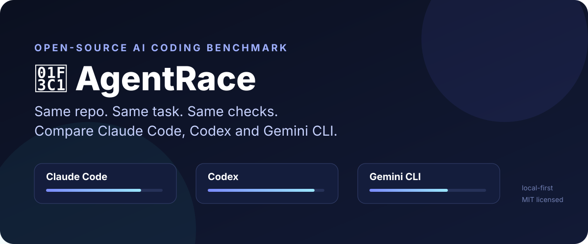
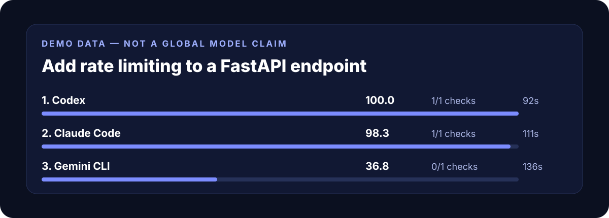

<div align="center">



# 🏁 AgentRace

### Race Claude Code, Codex and Gemini CLI on **your own codebase**.

**Same repo. Same task. Same checks. One reproducible local result.**

[](https://github.com/venzimprojects-lang/agentrace/actions/workflows/ci.yml)


</div>

---

## The idea

Generic leaderboards answer a broad question: *which model performs well on someone else's benchmark?*

AgentRace asks a narrower and often more useful one:

> **Which coding agent performs best on this task, in this repository, with these checks?**

It gives supported coding agents the same task in isolated Git worktrees, runs the same validation commands, then compares the results with an inspectable scoring formula.

No AgentRace account. No hosted judge. Results stay local.

## 30-second demo

You do **not** need Claude, Codex or Gemini installed to preview the UI:

```bash
git clone https://github.com/venzimprojects-lang/agentrace.git
cd agentrace
python -m venv .venv
source .venv/bin/activate  # Windows: .venv\Scripts\activate
pip install -e .
agentrace demo
```

That creates a standalone `agentrace-demo.html` report.



> The scores shown above are **demo data**, not a claim about global model quality.

## How it works

```text
                        ┌────────────────────┐
                        │     YOUR REPO      │
                        │    committed HEAD  │
                        └─────────┬──────────┘
                                  │
                       isolated Git worktrees
                 ┌────────────────┼────────────────┐
                 ▼                ▼                ▼
          ┌────────────┐    ┌────────────┐   ┌────────────┐
          │ Claude Code│    │   Codex    │   │ Gemini CLI │
          └─────┬──────┘    └─────┬──────┘   └─────┬──────┘
                │                 │                │
                └─────────────────┼────────────────┘
                                  ▼
                         same validation checks
                                  │
                                  ▼
                       deterministic score + report
```

## Run a real race

First check what is installed:

```bash
agentrace doctor
```

Then, from a Git repository with a clean committed `HEAD`:

```bash
agentrace run \
  "Add rate limiting to the FastAPI API" \
  --check "pytest -q"
```

Add more checks by repeating `--check`:

```bash
agentrace run \
  "Refactor the auth service without changing behavior" \
  -c "pytest -q" \
  -c "ruff check ." \
  -c "mypy src"
```

Generate a standalone report:

```bash
agentrace report -o result.html
```

## Supported agents

AgentRace currently detects and runs:

- **Claude Code** — `claude`
- **OpenAI Codex CLI** — `codex`
- **Google Gemini CLI** — `gemini`

Adapter commands are intentionally small and isolated because upstream CLIs evolve quickly.

## Why no LLM judge?

An LLM judging another LLM adds another model, another prompt and another source of variance.

AgentRace v0.1 instead uses an intentionally boring scoring formula:

- **25 points** — agent process completed successfully
- **60 points** — user-defined validation checks, split equally across checks
- **10 points** — relative execution speed among successful agents
- **5 points** — agent was available and runnable

If you provide no validation checks, AgentRace deliberately reduces the available quality score. Speed alone is not a useful coding benchmark.

The methodology and limitations are documented in [docs/BENCHMARKING.md](docs/BENCHMARKING.md).

## Fairness rules

1. Every agent starts from the exact same Git commit.
2. Every agent gets its own detached Git worktree.
3. Every agent receives the same task text and benchmark rules.
4. The same user-defined validation commands run after each agent.
5. Agents do not read each other's worktrees or results through AgentRace.

This makes a local race more reproducible, but **not scientifically universal**. Model versions, subscriptions, local config, enabled tools, network access and agent permissions can all change outcomes.

## What AgentRace is not

AgentRace is **not** a universal leaderboard and does not claim that one model is globally better than another.

It is a local harness for repeatable head-to-head comparisons on code you actually care about.

## Safety

Coding agents can execute commands. Git worktrees isolate repository copies, but they are **not a security sandbox**.

Do not benchmark untrusted repositories on a machine containing sensitive credentials. Review each agent's own sandbox and permission settings. See [SECURITY.md](SECURITY.md).

## Current status

v0.1 is an **alpha**. The core loop is working and CI runs on Linux, macOS and Windows with Python 3.11/3.12.

Roadmap:

- [x] CLI doctor
- [x] Claude / Codex / Gemini adapters
- [x] Isolated Git worktrees
- [x] Parallel racing
- [x] User-defined checks
- [x] Deterministic scoring
- [x] Standalone HTML report
- [ ] Partial test-result parsing (pytest, Vitest/Jest, Go test)
- [ ] Cost / token capture where agents expose it reliably
- [ ] Reusable benchmark suites
- [ ] SVG / PNG share cards from real race results
- [ ] More adapters
- [ ] GitHub Action mode

## Contributing

Issues and pull requests are welcome. See [CONTRIBUTING.md](CONTRIBUTING.md).

If you try AgentRace on a real repository, the most useful feedback is:

- what task you ran;
- which agents were installed;
- what checks you used;
- where the comparison felt unfair or misleading.

## License

MIT — see [LICENSE](LICENSE).
